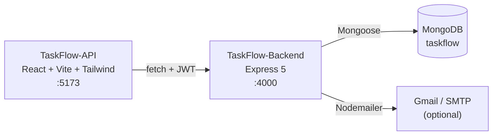

# TaskFlow

[](https://github.com/k-sahi/Cursor-Lab/actions/workflows/ci.yml)

A full-stack project and task manager. Sign up, create projects, add tasks with a status and a priority, and get in-app notifications (plus optional email) when things change.

- **Back end:** Express 5 REST API on MongoDB, JWT auth, per-user ownership on every query
- **Front end:** React 19 + Vite 7 + Tailwind 4 single-page app
- **Quality:** Jest unit and route tests against a real MongoDB, ESLint, GitHub Actions CI



## Features

- Register and log in with JWTs; passwords hashed with bcrypt
- Projects with per-user unique codes, pagination, and tasks embedded in one request (no N+1 queries)
- Tasks with an independent **status** (`todo`, `in_progress`, `in_review`, `blocked`, `done`) and **priority** (`low`, `medium`, `high`, `urgent`), editable from the UI
- Notifications for every change; email on project create and delete that never blocks the request if SMTP is down
- Consistent JSON errors: 400 for bad input or ids, 401 for missing or expired tokens, 404 for anything you don't own, 409 for duplicates
- Fails fast at startup when required config is missing

## Tech stack

| Layer | Tech | Where |
|---|---|---|
| Front end | React 19, Vite 7, Tailwind CSS 4 | `TaskFlow-API/` |
| Back end | Node.js, Express 5 (CommonJS) | `TaskFlow-Backend/` |
| Database | MongoDB via Mongoose 9 | `TaskFlow-Backend/src/models/` |
| Auth | JSON Web Tokens (`jsonwebtoken`), `bcryptjs` | `src/routes/auth.js`, `src/middleware/requireAuth.js` |
| Email | Nodemailer (Gmail app password or any SMTP server) | `src/services/emailService.js` |
| Tests | Jest, MongoDB service in CI | `TaskFlow-Backend/test/`, `.github/workflows/ci.yml` |
| Tooling | ESLint 9, Cursor rules, command and skill | `TaskFlow-API/eslint.config.js`, `.cursor/` |

> `TaskFlow-API` is the **front end** (React). The API server is `TaskFlow-Backend`.

## Getting started

### Prerequisites

| Tool | Version |
|---|---|
| [Node.js](https://nodejs.org/) | 22 LTS (minimum 20.19) |
| MongoDB | local server, Docker, or an Atlas cluster |

### 1. Start MongoDB

```bash
docker run -d --name taskflow-mongo -p 27017:27017 mongo:7
```

Or use a [MongoDB Atlas](https://www.mongodb.com/atlas) connection string in the next step.

### 2. Back end

```bash
git clone https://github.com/k-sahi/Cursor-Lab.git
cd Cursor-Lab/TaskFlow-Backend
npm install
cp .env.example .env      # set JWT_SECRET
npm start                 # http://localhost:4000
```

`JWT_SECRET` and `JWT_EXPIRES_IN` are required; the server refuses to start without them and says which is missing.

```bash
curl http://localhost:4000/
# {"status":"ok","message":"TaskFlow API is running"}
```

### 3. Front end (new terminal)

```bash
cd TaskFlow-API
npm install
npm run dev               # http://localhost:5173
```

The app calls `http://localhost:4000` by default; set `VITE_API_BASE` in `TaskFlow-API/.env.local` to use another API.

### Configuration

| Variable | Required | Default | Purpose |
|---|---|---|---|
| `JWT_SECRET` | yes | | Signing secret for tokens |
| `JWT_EXPIRES_IN` | yes | | Token lifetime, e.g. `7d` |
| `MONGO_URI` | no | `mongodb://localhost:27017/taskflow` | Database connection |
| `PORT` | no | `4000` | API port |
| `GMAIL_USER`, `GMAIL_APP_PASSWORD` | no | | Send email through Gmail ([app password](https://support.google.com/accounts/answer/185833)) |
| `SMTP_HOST`, `SMTP_PORT`, `SMTP_SECURE`, `SMTP_USER`, `SMTP_PASS` | no | | Any other SMTP provider |
| `MAIL_FROM` | no | `TaskFlow <GMAIL_USER>` | From header |

Without email settings, sends fail quietly in the log and requests still succeed.

### Database migration

Tasks created before status and priority were split store workflow states in `priority`. Convert them once (safe to re-run):

```bash
cd TaskFlow-Backend && npm run migrate:tasks
```

## Testing

```bash
cd TaskFlow-Backend
npm test                                              # unit tests, no database needed
MONGO_URI_TEST=mongodb://localhost:27017 npm test     # plus route tests against MongoDB
```

Route tests run the real app over HTTP against a throwaway database: auth, token errors, cross-user ownership (another user gets 404 on every project and task route), pagination, cascading deletes, task fields and the migration. CI runs them against a `mongo:7` service on every push, and lints and builds the front end.

## API

All routes are under `/api` and return JSON. Protected routes take `Authorization: Bearer <token>`.

| Method | Path | Body / query | Returns |
|---|---|---|---|
| POST | `/api/auth/register` | `name, email, password` | `201 { token, user }` |
| POST | `/api/auth/login` | `email, password` | `{ token, user }` |
| GET | `/api/auth/me` | | `{ user }` |
| GET | `/api/projects` | `?page=1&limit=6` | `{ projects, pagination }` |
| POST | `/api/projects` | `name, code, description?` | `201 { project }` |
| GET / PUT / DELETE | `/api/projects/:id` | PUT: any of `name, code, description` | `{ project }` / `204` |
| GET | `/api/projects/:projectId/tasks` | | `{ tasks }` |
| POST | `/api/projects/:projectId/tasks` | `title, status?, priority?` | `201 { task }` |
| PUT | `/api/projects/:projectId/tasks/:taskId` | any of `title, status, priority` | `{ task }` |
| DELETE | `/api/projects/:projectId/tasks/:taskId` | | `204` |
| GET / DELETE | `/api/notifications` | GET: `?limit=50` | `{ notifications }` / `204` |

Details, error codes and design notes: [docs/architecture.md](docs/architecture.md).

## Project structure

```
TaskFlow-Backend/
  server.js         config check, Mongo connection, listen
  src/app.js        Express app: middleware, routes, 404, error handler
  src/config.js     JWT settings
  src/models/       User, Project, Task, Notification
  src/routes/       auth, projects (+ nested tasks), notifications
  src/middleware/   requireAuth, errorHandler
  src/services/     notificationService, emailService
  src/utils/        logger, validation
  scripts/          migrate-task-status.js
  test/             auth, unit and route tests
TaskFlow-API/
  src/App.jsx       UI: auth, dashboard, projects, tasks, notifications
  src/index.css     Tailwind + theme tokens
.cursor/            rules, /add-logging command, /generate skill
.github/workflows/  ci.yml
docs/               architecture.md, coding-practices.md
```
