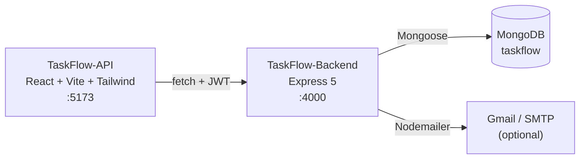

# Cursor Lab: building TaskFlow with Cursor

TaskFlow is a small project and task manager: sign up, create projects, add tasks with a priority, and get a notification (and optionally an email) when things change. The app itself is deliberately ordinary. **The point of this repo is how it was built:** feature by feature with Cursor, then taught Cursor's own conventions through project rules, a custom command, a skill and a cloud agent.

Follow along commit by commit, or clone the finished version and poke at it.



## What you'll learn

- A clean Express + MongoDB REST API: JWT auth, ownership checks, nested routes, a consistent response shape
- A React front end that talks to it with plain `fetch` and a token in `localStorage`
- Side effects that must not break the main request (notifications and email)
- Unit testing a service with Jest mocks
- Cursor workflow: `.cursor/rules` (repo and directory-scoped), `.cursor/commands` (`/add-logging`), `.cursor/skills` (`/generate`) and handing work to a cloud agent

## Tech stack

| Layer | Tech | Where |
|---|---|---|
| Front end | React 19, Vite 7, Tailwind CSS 4 | `TaskFlow-API/` |
| Back end | Node.js, Express 5 (CommonJS) | `TaskFlow-Backend/` |
| Database | MongoDB via Mongoose 9 | `TaskFlow-Backend/src/models/` |
| Auth | JSON Web Tokens (`jsonwebtoken`), passwords hashed with `bcryptjs` | `src/routes/auth.js`, `src/middleware/requireAuth.js` |
| Email | Nodemailer (Gmail app password or any SMTP server) | `src/services/emailService.js` |
| Tests | Jest | `src/services/notificationService.test.js` |
| Editor | Cursor | `.cursor/` |

> Naming gotcha: `TaskFlow-API` is the **front end** (React). The API server is `TaskFlow-Backend`.

## Setup guide

### 1. Install the prerequisites

| Tool | Version | Check |
|---|---|---|
| [Node.js](https://nodejs.org/) | 22 LTS (minimum 20.19; Vite 7 and Mongoose 9 need it) | `node -v` |
| Git | any recent | `git --version` |
| MongoDB | local server, Docker, or a free Atlas cluster | see step 3 |
| [Cursor](https://cursor.com/) | latest | to use the rules, command and skill |

### 2. Clone

```bash
git clone https://github.com/bytemonkio/Cursor-Lab.git
cd Cursor-Lab
```

### 3. Start MongoDB (pick one)

```bash
# Docker (easiest)
docker run -d --name taskflow-mongo -p 27017:27017 mongo:7

# macOS with Homebrew
brew tap mongodb/brew && brew install mongodb-community
brew services start mongodb-community
```

Or create a free cluster on [MongoDB Atlas](https://www.mongodb.com/atlas) and copy its connection string for the next step.

### 4. Configure and run the back end

```bash
cd TaskFlow-Backend
npm install
cp .env.example .env      # then open .env and set JWT_SECRET
npm start                 # http://localhost:4000
```

`JWT_SECRET` and `JWT_EXPIRES_IN` are **required**. Without them, register and login fail with a 500. Email settings are optional; see [Email](#optional-email).

Check it's alive:

```bash
curl http://localhost:4000/
# {"status":"ok","message":"TaskFlow API is running"}
```

### 5. Run the front end (new terminal)

```bash
cd TaskFlow-API
npm install
npm run dev               # http://localhost:5173
```

The app calls `http://localhost:4000` by default. To point it elsewhere, create `TaskFlow-API/.env.local` with `VITE_API_BASE=https://your-api`.

### 6. Try it

Open http://localhost:5173, register, create a project, add a few tasks, change a task's priority, and open the notifications panel.

### 7. Run the tests

```bash
cd TaskFlow-Backend
npm test
```

### Optional: email

Project create and delete also send an email. With nothing configured, the send fails, gets logged, and the request still succeeds (that's on purpose; see the deep dive). To receive real mail, put a Gmail address and a [Google app password](https://support.google.com/accounts/answer/185833) (needs 2-Step Verification) in `GMAIL_USER` and `GMAIL_APP_PASSWORD`, or fill in the `SMTP_*` values for any other provider.

## Repo layout

```
.cursor/
  rules/            coding-standards.md (whole repo), backend.md (TaskFlow-Backend only)
  commands/         add-logging.md  →  /add-logging in Cursor chat
  skills/generate/  SKILL.md        →  /generate: scan the repo and write its coding rules
TaskFlow-Backend/
  server.js         app setup, Mongo connection, route mounting, global error handler
  src/models/       User, Project, Task, Notification
  src/routes/       auth, projects (+ nested tasks), notifications
  src/middleware/   requireAuth
  src/services/     notificationService, emailService (+ Jest test)
  src/utils/        logger
TaskFlow-API/
  src/App.jsx       the whole UI: auth, dashboard, projects, tasks, notifications
  src/index.css     Tailwind + ByteMonk theme tokens
```

## Follow along, commit by commit

Each step is tagged, so you can check it out and see the app at that stage.

| Step | Tag | What gets added |
|---|---|---|
| 1 | `step-1-auth` | User auth: register, login, JWT, `User` model, login screen |
| 2 | `step-2-projects` | Projects CRUD, `requireAuth` middleware, ownership checks |
| 3 | `step-3-tasks` | Tasks CRUD nested under projects, `Task` model |
| 4 | `step-4-branding` | ByteMonk branding |
| 5 | `step-5-notifications` | Notifications (model, service, route) and the email service |
| 6 | `step-6-error-handling` | Error handling in the notification and email services |
| 7 | `step-7-cursor-agent` | Cursor cloud agent pass: `.cursor/` rules, command and skill, structured logger, Jest tests, task priorities, project pagination |

```bash
git checkout step-1-auth             # jump to a step (read-only "detached HEAD")
npm install                          # in each app folder; dependencies change between steps
git switch main                      # back to the finished version
```

## Go deeper

- [Deep dive](docs/deep-dive.md): request lifecycle, auth, data model, API reference, the notification design, tests, how each Cursor feature is used, and exercises
- [Coding standards](.cursor/rules/coding-standards.md): the rules Cursor follows in this repo, in the format the `/generate` skill produces
