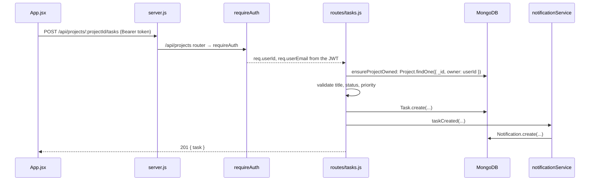

# Architecture

How TaskFlow works: request lifecycle, auth, data model, API reference, side effects, front end, tests and the Cursor setup.

---

## 1. How a request flows

Adding a task to a project, from click to database and back:



Four design rules shape the back end:

1. **Everything lives under `/api/*`.** `src/app.js` mounts three routers: `auth`, `projects` and `notifications`. Tasks are not mounted at the top level; they hang off projects (`router.use('/:projectId/tasks', ...)` in `projects.js`) with `mergeParams: true` so the tasks router can read `:projectId`.
2. **Auth is middleware, not a per-route check.** Protected routers call `router.use(requireAuth)` once at the top.
3. **Ownership is a query, not an `if`.** Every lookup includes `owner: req.userId`. Someone else's project simply isn't found, so the API returns `404`, which also avoids leaking that the id exists.
4. **Side effects run after the write.** The notification is recorded only once the database mutation succeeded.

## 2. Auth

`src/routes/auth.js` and `src/middleware/requireAuth.js`.

- **Register** (`POST /api/auth/register`): validates `name`, `email`, `password`, rejects duplicates with `409`, hashes the password with bcrypt (cost 10) and stores only `passwordHash`.
- **Login** (`POST /api/auth/login`): the `passwordHash` field has `select: false` on the schema, so login explicitly asks for it with `.select('+passwordHash')`. Wrong email and wrong password return the **same** `401` message, so an attacker can't probe which emails exist.
- **Token:** both endpoints sign a JWT with `sub` (user id) and `email`, using `JWT_SECRET` and `JWT_EXPIRES_IN`, read only through `getJwtConfig()` in `src/config.js`. There is no fallback secret; `server.js` refuses to start if either value is missing.
- **Me** (`GET /api/auth/me`): the front end calls this on load to validate a stored token. It is protected by `requireAuth` like every other route.
- **requireAuth:** reads `Authorization: Bearer <token>`, verifies it, and puts `req.userId` and `req.userEmail` on the request. Missing, malformed, wrongly signed or expired tokens get `401 { message }` (`"Token expired"` for the last), never a 500.

On the front end, the token and user are kept in `localStorage` under `tf_token` and `tf_user` and sent on every call.

## 3. Data model

`src/models/`. All four schemas use `{ timestamps: true }` (Mongoose adds `createdAt` / `updatedAt`).

| Model | Key fields | Notes |
|---|---|---|
| `User` | `name`, `email` (unique, lowercased), `passwordHash` (hidden by default) | `hashPassword` static, `comparePassword` method |
| `Project` | `owner` → User, `name`, `code` (uppercased), `description` | unique index on `{ owner, code }`: codes are unique **per user** |
| `Task` | `project` → Project, `title`, `status`, `priority` | `status` ∈ `todo` (default), `in_progress`, `in_review`, `blocked`, `done` (`Task.STATUSES`); `priority` ∈ `low`, `medium` (default), `high`, `urgent` (`Task.PRIORITIES`) |
| `Notification` | `user` → User, `type`, `title`, `message` | index on `{ user, createdAt: -1 }` to serve "newest first" |

Deleting a project also deletes its tasks (`Task.deleteMany` in `projects.js`). MongoDB has no foreign-key cascade; the app does it.

## 4. API reference

All responses are JSON. Collections come back as `{ <plural>: [...] }`, single items as `{ <singular>: {...} }`, errors as `{ message }`.

Error statuses: `400` for missing or invalid fields, a malformed id or malformed JSON; `401` for a missing, invalid or expired token; `404` for anything you don't own; `409` for a duplicate email or a duplicate project code for the same user; `500` (generic message, details only in the server log) for everything else. These mappings live in `src/middleware/errorHandler.js`.

| Method | Path | Auth | Body / query | Returns |
|---|---|---|---|---|
| POST | `/api/auth/register` | | `name, email, password` | `201 { token, user }` |
| POST | `/api/auth/login` | | `email, password` | `{ token, user }` |
| GET | `/api/auth/me` | ✓ | | `{ user }` |
| GET | `/api/projects` | ✓ | `?page=1&limit=6` (max 50) | `{ projects (each with tasks), pagination }` |
| POST | `/api/projects` | ✓ | `name, code, description?` | `201 { project }` |
| GET | `/api/projects/:id` | ✓ | | `{ project }` |
| PUT | `/api/projects/:id` | ✓ | any of `name, code, description` | `{ project }` |
| DELETE | `/api/projects/:id` | ✓ | | `204` (tasks deleted too) |
| GET | `/api/projects/:projectId/tasks` | ✓ | | `{ tasks }` |
| POST | `/api/projects/:projectId/tasks` | ✓ | `title, status?, priority?` | `201 { task }` |
| PUT | `/api/projects/:projectId/tasks/:taskId` | ✓ | any of `title, status, priority` | `{ task }` |
| DELETE | `/api/projects/:projectId/tasks/:taskId` | ✓ | | `204` |
| GET | `/api/notifications` | ✓ | `?limit=50` (max 100) | `{ notifications }` |
| DELETE | `/api/notifications` | ✓ | | `204` (clears all) |

Try it from a terminal:

```bash
TOKEN=$(curl -s -X POST localhost:4000/api/auth/register \
  -H 'Content-Type: application/json' \
  -d '{"name":"Ada","email":"ada@example.com","password":"secret123"}' | node -pe 'JSON.parse(require("fs").readFileSync(0)).token')

curl -s -X POST localhost:4000/api/projects -H "Authorization: Bearer $TOKEN" \
  -H 'Content-Type: application/json' -d '{"name":"Launch","code":"lnch"}'
```

`GET /api/projects` returns each project **with its tasks embedded**. It does this in two queries (one page of projects, then all their tasks with `$in`) and groups in memory, instead of one query per project. That is the classic fix for the N+1 query problem.

## 5. Notifications and email: failure isolation

`src/services/notificationService.js` and `emailService.js`.

Every create, update and delete calls a helper such as `taskCreated(...)`, which calls `record(...)`:

1. Write a `Notification` document.
2. If an email address was passed, try to send an email. **If that fails, log it and carry on.**
3. If the database write itself fails, log it and throw `Failed to record notification`.

The design question is: which failures should break the user's request? An SMTP outage should not stop someone creating a task, so email errors are caught and logged. Only project create and delete pass an email address; updates and task events notify in-app only, which keeps inboxes quiet.

`emailService` picks its transport at startup: Gmail when `GMAIL_USER` and `GMAIL_APP_PASSWORD` are set, otherwise generic SMTP from `SMTP_HOST`, `SMTP_PORT`, `SMTP_SECURE`, `SMTP_USER`, `SMTP_PASS`.

Logging goes through `src/utils/logger.js`: `createLogger('notificationService')` returns `info` and `error` functions that prefix a timestamp, the module name and the level. Small, but it makes logs greppable.

## 6. Front end

`TaskFlow-API/src/App.jsx` holds the whole UI in three components:

- `App`: login / register form, owns `token` and `user`, validates a stored token against `/api/auth/me` on load.
- `Dashboard`: paginated project list, project create / edit form, notifications panel.
- `ProjectTasks`: tasks for one project, inline title editing, and two badge menus (status and priority) that send only the changed field.

There is no router and no state library: `useState`, `useEffect` and `fetch`. The API base comes from `import.meta.env.VITE_API_BASE` with a `http://localhost:4000` fallback. Styling is Tailwind 4 with brand colour tokens declared in `src/index.css` under `@theme`.

## 7. Tests

`npm test` runs four suites:

| File | Kind | Needs MongoDB |
|---|---|---|
| `src/services/notificationService.test.js` | service unit tests with mocks | no |
| `test/requireAuth.test.js` | auth middleware and config | no |
| `test/units.test.js` | `validateEnum`, Task model, error handler | no |
| `test/routes.test.js` | the real app over HTTP: auth, ownership, tasks, pagination, migration | yes (`MONGO_URI_TEST`) |

```bash
docker run -d --name taskflow-mongo -p 27017:27017 mongo:7
MONGO_URI_TEST=mongodb://localhost:27017 npm test
```

Without `MONGO_URI_TEST` the route tests are skipped, so `npm test` still works offline. GitHub Actions (`.github/workflows/ci.yml`) runs everything against a MongoDB service on every push, and lints and builds the front end.

### The notification service test

The service talks to MongoDB, email and the logger, so the test replaces all three with `jest.mock(...)`. That lets it check behaviour, not infrastructure:

- the right document is created and returned
- email is sent only when an address is given, with `title` as the fallback body
- an email failure is logged and **does not** reject
- a database failure rejects with the generic error
- each `projectX` / `taskX` helper builds the right type, title and message

The logger mock is shared (`loggerMock`) so the test can assert on log calls, which works for any module that creates its logger at import time.

## 8. Cursor setup

The repo is developed with Cursor, and its conventions are committed under `.cursor/` so every agent run follows them.

- **Rules** (`.cursor/rules/`): `coding-standards.md` applies repo-wide (structure, style, API shapes, validation, ownership, logging, testing). `backend.md` scopes back-end rules to `TaskFlow-Backend/**` so they don't leak into the React code.
- **Command** (`.cursor/commands/add-logging.md`, run as `/add-logging`): adds a module logger, a log line at the start of every function with context, and error logging in every `catch`. `notificationService.js` and `routes/projects.js` follow it.
- **Skill** (`.cursor/skills/generate/SKILL.md`, run as `/generate`): scans the repo, infers the conventions it actually follows, records inconsistencies, and writes [coding-practices.md](coding-practices.md) and `.cursor/rules/coding-standards.md`.
