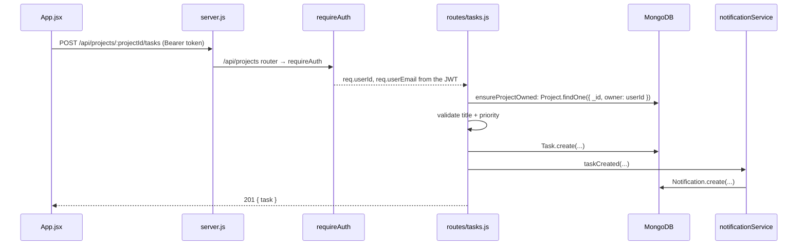

# Deep dive

The long version of the [README](../README.md). Read it with the code open: every section points at the file it describes.

---

## 1. How a request flows

Take "add a task to a project" from click to database and back:



Four ideas carry the whole back end:

1. **Everything lives under `/api/*`.** `server.js` mounts three routers: `auth`, `projects` and `notifications`. Tasks are not mounted at the top level; they hang off projects (`router.use('/:projectId/tasks', ...)` in `projects.js`) with `mergeParams: true` so the tasks router can read `:projectId`.
2. **Auth is middleware, not a per-route check.** Protected routers call `router.use(requireAuth)` once at the top.
3. **Ownership is a query, not an `if`.** Every lookup includes `owner: req.userId`. Someone else's project simply isn't found, so the API returns `404`, which also avoids leaking that the id exists.
4. **Side effects run after the write.** The notification is recorded only once the database mutation succeeded.

## 2. Auth

`src/routes/auth.js` and `src/middleware/requireAuth.js`.

- **Register** (`POST /api/auth/register`): validates `name`, `email`, `password`, rejects duplicates with `409`, hashes the password with bcrypt (cost 10) and stores only `passwordHash`.
- **Login** (`POST /api/auth/login`): the `passwordHash` field has `select: false` on the schema, so login explicitly asks for it with `.select('+passwordHash')`. Wrong email and wrong password return the **same** `401` message, so an attacker can't probe which emails exist.
- **Token:** both endpoints sign a JWT with `sub` (user id) and `email`, using `JWT_SECRET` and `JWT_EXPIRES_IN`.
- **Me** (`GET /api/auth/me`): the front end calls this on load to validate a stored token.
- **requireAuth:** reads `Authorization: Bearer <token>`, verifies it, and puts `req.userId` and `req.userEmail` on the request.

On the front end, the token and user are kept in `localStorage` under `tf_token` and `tf_user` and sent on every call.

## 3. Data model

`src/models/`. All four schemas use `{ timestamps: true }` (Mongoose adds `createdAt` / `updatedAt`).

| Model | Key fields | Notes |
|---|---|---|
| `User` | `name`, `email` (unique, lowercased), `passwordHash` (hidden by default) | `hashPassword` static, `comparePassword` method |
| `Project` | `owner` → User, `name`, `code` (uppercased), `description` | unique index on `{ owner, code }`: codes are unique **per user** |
| `Task` | `project` → Project, `title`, `priority` | `priority` ∈ `urgent`, `blocked`, `in_review` (default), exposed as `Task.PRIORITIES` |
| `Notification` | `user` → User, `type`, `title`, `message` | index on `{ user, createdAt: -1 }` to serve "newest first" |

Deleting a project also deletes its tasks (`Task.deleteMany` in `projects.js`). MongoDB has no foreign-key cascade; the app does it.

## 4. API reference

All responses are JSON. Collections come back as `{ <plural>: [...] }`, single items as `{ <singular>: {...} }`, errors as `{ message }`.

| Method | Path | Auth | Body / query | Returns |
|---|---|---|---|---|
| POST | `/api/auth/register` | | `name, email, password` | `201 { token, user }` |
| POST | `/api/auth/login` | | `email, password` | `{ token, user }` |
| GET | `/api/auth/me` | ✓ | | `{ user }` |
| GET | `/api/projects` | ✓ | `?page=1&limit=6` (max 50) | `{ projects (each with tasks), pagination }` |
| POST | `/api/projects` | ✓ | `name, code, description?` | `201 { project }` |
| GET | `/api/projects/:id` | ✓ | | `{ project }` |
| PUT | `/api/projects/:id` | ✓ | any of `name, code, description` | `{ project }` |
| DELETE | `/api/projects/:id` | ✓ | | `204` (tasks deleted too) |
| GET | `/api/projects/:projectId/tasks` | ✓ | | `{ tasks }` |
| POST | `/api/projects/:projectId/tasks` | ✓ | `title, priority?` | `201 { task }` |
| PUT | `/api/projects/:projectId/tasks/:taskId` | ✓ | `title, priority?` | `{ task }` |
| DELETE | `/api/projects/:projectId/tasks/:taskId` | ✓ | | `204` |
| GET | `/api/notifications` | ✓ | `?limit=50` (max 100) | `{ notifications }` |
| DELETE | `/api/notifications` | ✓ | | `204` (clears all) |

Try it from a terminal:

```bash
TOKEN=$(curl -s -X POST localhost:4000/api/auth/register \
  -H 'Content-Type: application/json' \
  -d '{"name":"Ada","email":"ada@example.com","password":"secret123"}' | node -pe 'JSON.parse(require("fs").readFileSync(0)).token')

curl -s -X POST localhost:4000/api/projects -H "Authorization: Bearer $TOKEN" \
  -H 'Content-Type: application/json' -d '{"name":"Launch","code":"lnch"}'
```

`GET /api/projects` returns each project **with its tasks embedded**. It does this in two queries (one page of projects, then all their tasks with `$in`) and groups in memory, instead of one query per project. That is the classic fix for the N+1 query problem.

## 5. Notifications and email: failure isolation

`src/services/notificationService.js` and `emailService.js`.

Every create, update and delete calls a helper such as `taskCreated(...)`, which calls `record(...)`:

1. Write a `Notification` document.
2. If an email address was passed, try to send an email. **If that fails, log it and carry on.**
3. If the database write itself fails, log it and throw `Failed to record notification`.

The design question is: which failures should break the user's request? An SMTP outage should not stop someone creating a task, so email errors are caught and logged. Only project create and delete pass an email address; updates and task events notify in-app only, which keeps inboxes quiet.

`emailService` picks its transport at startup: Gmail when `GMAIL_USER` and `GMAIL_APP_PASSWORD` are set, otherwise generic SMTP from `SMTP_HOST`, `SMTP_PORT`, `SMTP_SECURE`, `SMTP_USER`, `SMTP_PASS`.

Logging goes through `src/utils/logger.js`: `createLogger('notificationService')` returns `info` and `error` functions that prefix a timestamp, the module name and the level. Small, but it makes logs greppable.

## 6. Front end

`TaskFlow-API/src/App.jsx` holds the whole UI in three components:

- `App`: login / register form, owns `token` and `user`, validates a stored token against `/api/auth/me` on load.
- `Dashboard`: paginated project list, project create / edit form, notifications panel.
- `ProjectTasks`: tasks for one project, inline title editing, a priority menu.

There is no router and no state library: `useState`, `useEffect` and `fetch`. The API base comes from `import.meta.env.VITE_API_BASE` with a `http://localhost:4000` fallback. Styling is Tailwind 4 with ByteMonk colour tokens declared in `src/index.css` under `@theme`.

## 7. Tests

`src/services/notificationService.test.js`, run with `npm test`.

The service talks to MongoDB, email and the logger, so the test replaces all three with `jest.mock(...)`. That lets it check behaviour, not infrastructure:

- the right document is created and returned
- email is sent only when an address is given, with `title` as the fallback body
- an email failure is logged and **does not** reject
- a database failure rejects with the generic error
- each `projectX` / `taskX` helper builds the right type, title and message

Look at how the logger mock is shared (`loggerMock`) so the test can assert on log calls. It's a useful pattern for any module that creates its logger at import time.

## 8. How Cursor is used in this repo

This is the part the project exists to teach. Everything lives in `.cursor/` and is committed, so the whole team (and every agent) gets the same behaviour.

### Rules: `.cursor/rules/`

Rules are standing instructions Cursor's agent reads before it edits code.

- `coding-standards.md`: repo-wide. Structure, quote and semicolon style, the `/api/*` prefix, `requireAuth`, response shapes, validation, ownership checks, "email failures must not fail the request", front-end storage keys. It ends with a **fix-now** list of inconsistencies it found.
- `backend.md`: scoped to `TaskFlow-Backend/**` and explicitly **not** the React code. This is how you keep back-end conventions from leaking into the front end.

Rules are the "why is the AI suddenly writing code the way our team does" lever. Try deleting one, ask the agent for a new endpoint, and compare.

### Commands: `.cursor/commands/add-logging.md`

A saved prompt you run as `/add-logging` in Cursor chat: import the logger, create one per module, log at the start of every function with context, log in every `catch`. Compare `notificationService.js` before and after tag `step-7-cursor-agent` to see its output.

### Skills: `.cursor/skills/generate/SKILL.md`

A bigger, reusable procedure run as `/generate`. It tells the agent how to scan the repo, infer the conventions that actually exist (not the ideal ones), record inconsistencies, and write both a human doc and a `.cursor/rules/coding-standards.md`. Commands are one-shot prompts; skills carry a method and an output format.

### Cloud agent

The commit tagged `step-7-cursor-agent` ("Cursor: Apply local changes for cloud agent") came from a Cursor cloud agent. It is the biggest single change in the history: rules, command, skill, logger, tests, priorities and pagination. Read its diff to see how much one well-briefed agent run can do, and what you would want to review before merging.

## 9. Exercises

Real rough edges in the code, good for practising with Cursor:

1. **Duplicate `/` route.** `server.js` registers `app.get('/')` twice. Express uses the first, so "Subscribe to ByteMonk" never shows. Keep one. (It's on the fix-now list in `coding-standards.md`.)
2. **Inconsistent JWT secret.** `requireAuth` falls back to `'dev-secret-change-me'`; `auth.js` has no fallback and fails when `JWT_SECRET` is missing. Make them consistent, ideally by failing fast at startup.
3. **Bad tokens return 500, not 401.** `jwt.verify` throws on an expired or malformed token, and neither `requireAuth` nor `/me` catches it, so the global error handler answers `500`. Wrap it and return `401 { message }`. Write a test first.
4. **`/me` duplicates `requireAuth`.** Refactor it to use the middleware.
5. **Priority vs status.** `urgent`, `blocked` and `in_review` read more like statuses than priorities. Split them into two fields, with a validator for each, and update the UI menu.
6. **Route tests.** Only the service is tested. Add endpoint tests (for example with `supertest`) for auth and ownership (user B must get `404` on user A's project).
7. **Run the tools.** Use `/add-logging` on `routes/projects.js`, then `/generate` and diff the new rules against the committed ones.
